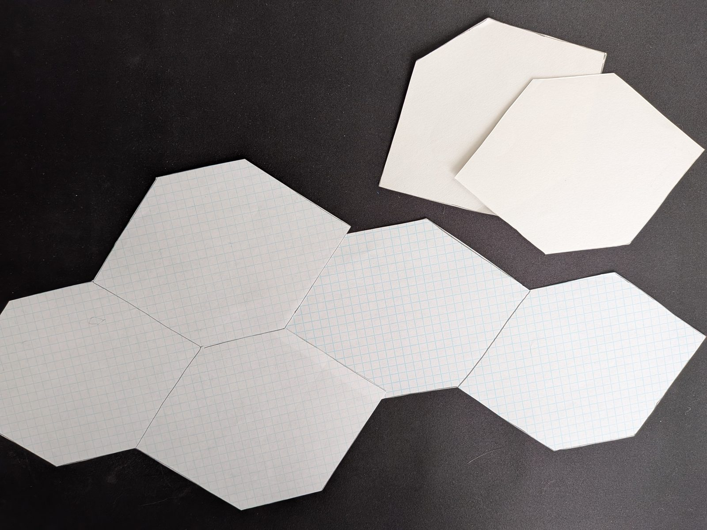

# Commentary on Orbs of Magic

This is the first game I added to my GitHub page. It is a game that I workshopped briefly in-person with a friend, by cutting a hex grid out of graph paper and drawing unit cards on paper.

The game itself was written in one shot (with some follow-up for polish) by Claude Opus 5.5 via Claude Cowork. The music was also composed by Claude in the same session.

I was surprised at how effective Claude was at creating the game. It does not match my initial vision for what the game should be, but it is in many ways better. Originally, I had envisioned the two Sanctums at opposing corners of the map with only a few hexes around them for access. I thought this would force players to make interesting tactical decisions about which units can attack the Sanctum at any given time, but I realize now that it would have practically stifled some of the more aggressive "go-wide" strategies.

My original vision for the game was also much slower, and did not feature the three Orbs in the middle of the map as "mini-objectives" to fight over (note the "Void space" in the above image). I knew I wanted some sort of mini-objective like this for the players to compete over, and I am satisfied with the version that Claude came up with completely unprompted.

Overall, I do not think this game ever would have come to fruition without Claude's assistance. I have many ideas but not much motivation to actually build them, and Claude has helped immensely in that regard. It is also freeing to see an idea "come to life" like this, so to speak, so that I don't have to keep holding on to it in my own head and can free up my attention for more important matters.
